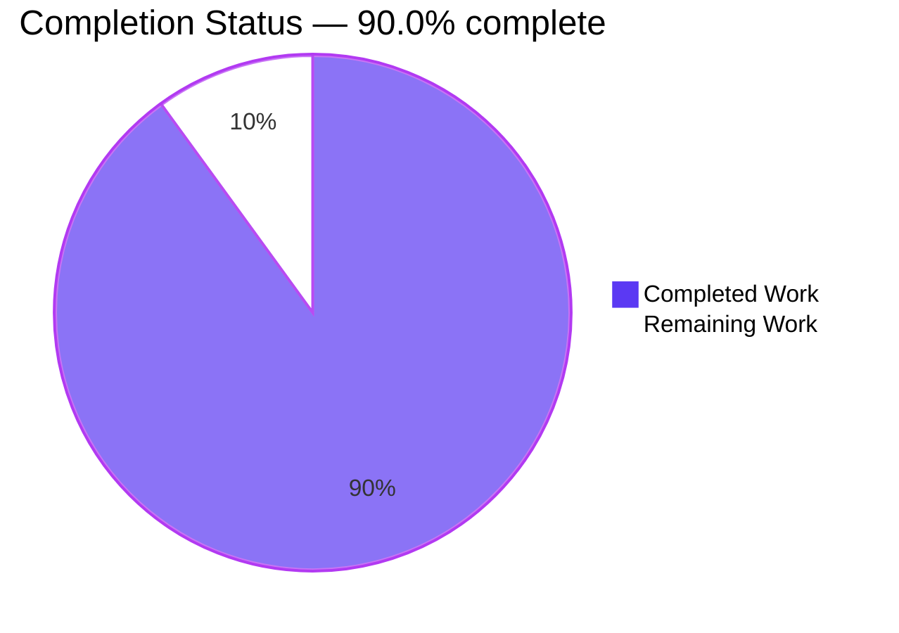
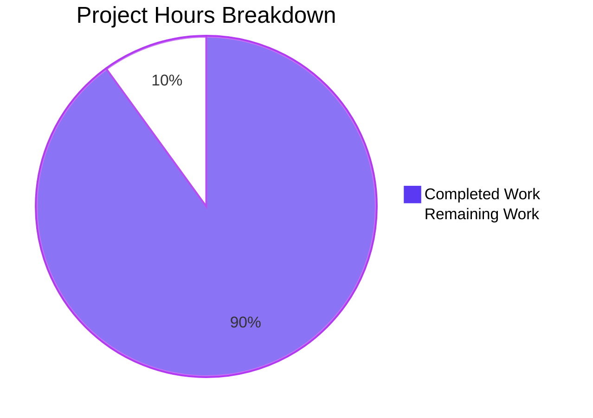
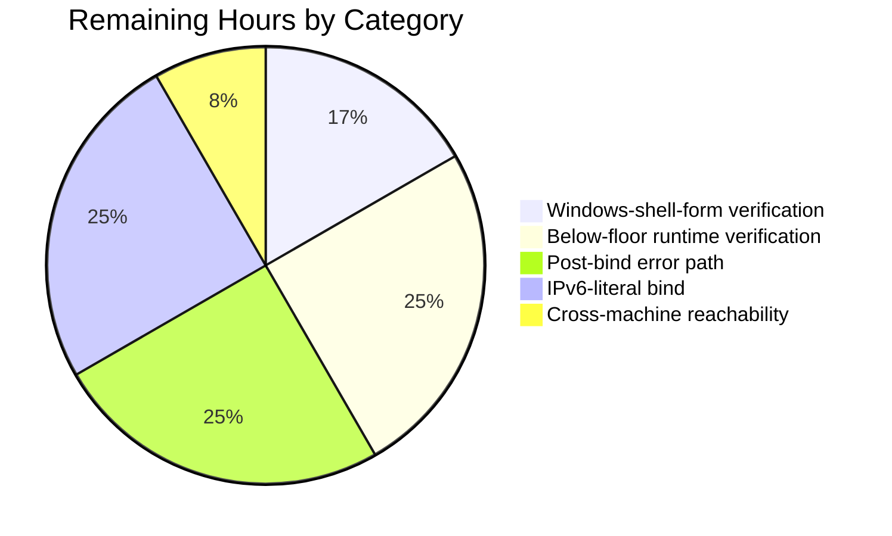

# 1. Executive Summary

## 1.1 Project Overview

A greenfield Node.js tutorial project: one HTTP server built on the runtime's own `node:http` module, with exactly one endpoint. A `GET` to `/hello` returns the literal text `Hello world` to the calling HTTP client; every other path or method receives a defined response. It is a teaching artifact, readable end to end in one sitting, so three things are in scope: the server, the automated check of it, and the tutorial that walks a reader from a clean checkout to a verified response. Nothing is installed, and the listener binds loopback on port 3000 by default.

## 1.2 Completion Status

The project was scoped against 48 requirements: 46 complete, 2 partially complete, none unstarted. Completion is hours-based — **54.0 completed of 60.0 total = 90.0%**.



| Metric | Hours |
|---|---|
| Total Hours | 60.0 |
| Completed Hours (AI + Manual) | 54.0 |
| Remaining Hours | 6.0 |

The remaining 6.0 hours are verification, not missing behaviour.

## 1.3 Key Accomplishments

- `GET /hello` returns `200 OK` with `Content-Type: text/plain; charset=utf-8`, `Content-Length: 11` and exactly the 11 bytes `Hello world`.
- Every other request target is `404`; a non-`GET` on `/hello` is `405` with `Allow: GET`; `HEAD` carries no body.
- `HOST` and `PORT` override the defaults, and `PORT=0` binds a free port the startup line names.
- Startup failures write one line and exit non-zero, with no retry and no stack trace.
- Five automated cases run over real sockets with the runtime's own runner: 5 pass, 0 fail.
- Zero dependencies, no install step and no configuration file; the public surface is exactly `handleRequest` and `start`.
- The tutorial reproduces every value the application produces, and the pre-existing `README.md` is untouched.

## 1.4 Critical Unresolved Issues

Five open items, all verification gaps. **5 of the 48 requirements carry an outstanding verification item; none blocks release.**

| Issue | Impact | Owner | ETA |
|---|---|---|---|
| The two Windows-cmd override forms (`set PORT=4000 && npm start`, `set HOST=0.0.0.0 && npm start`) have never been executed on any platform; their text is fixed by specification, so it cannot be reworded out of the gap | The syntax is stated correctly but is unproven on Windows; the mechanism itself is proven through bash/zsh and PowerShell runs | Maintainer with a Windows host | 1 day |
| The below-floor runtime symptom has never been reproduced: no run on Node 18.x/20.x has been performed, and the suite's entry-point case has therefore never been observed failing for that reason | The tutorial's claim about an older runtime rests on the documented behaviour of the entry-point guard, and the suite's loud failure on that path is designed but not observed | Maintainer | 1 day |
| The post-bind error path (an error raised while the server is already serving) has no automated test and no OS-level trigger on this host | Its one-line, no-exit-status, keeps-serving contract is proven by driving the listener directly rather than by an operational trigger | Maintainer | 2 days |
| The bracketed IPv6 startup line has never been called end to end: this host has no routable IPv6, so a `::1` bind fails | The bracketing is verified by the printed bytes and a URL parse, but no request has been made through that printed URL | Maintainer with an IPv6-capable host | 2 days |
| The documented cross-machine reachability of a wildcard bind was not exercised from a second host | The exposure description is verified on loopback and on this machine's routable addresses only | Maintainer with two hosts | 1 day |

## 1.5 Access Issues

No access issues identified: no credential, external service, network access or elevated permission is required.

## 1.6 Recommended Next Steps

1. **[Medium]** Verify the two Windows-cmd override forms on a Windows host — 1.0 h.
2. **[Medium]** Reproduce the below-floor runtime symptom on Node 18.x/20.x — 1.5 h.
3. **[Low]** Exercise the post-bind error path under a low file-descriptor limit — 1.5 h.
4. **[Low]** Call a bracketed IPv6-literal endpoint and confirm the printed URL works — 1.5 h.
5. **[Low]** Confirm a wildcard bind's cross-machine reachability, and weigh adding a job that runs `npm test` — 0.5 h.

# 2. Project Hours Breakdown

Every component below is a delivered file, and the last two lines are the work of proving that the files do what they claim.

## 2.1 Completed Work Detail

| Component | Hours | Description |
|---|---|---|
| `server.js` — endpoint, boundary and lifecycle | 16.0 | The single route and its `200`/`404`/`405`/`HEAD` outcomes, the response helper that sets the media type and the byte-measured length in one place, `HOST`/`PORT` resolution with pre-bind validation, the `start({ host, port })` factory, the one-line startup-failure and post-bind error reports, and the entry-point guard. |
| `test/hello.test.js` — automated HTTP check | 8.0 | Five cases over real sockets: the contract with its two headers and exact body, the unknown-path `404`, the exact-match `404` for `/hello/`, the `405` with `Allow: GET`, and the entry point spawned as a child process that asserts its startup line and serves a request through it. |
| `package.json` — project manifest | 2.0 | The seven keys that make the project a project: the module system, the advisory runtime floor, and the `start` and `test` scripts the reader types. |
| `TUTORIAL.md` — the reader's path | 10.0 | Prerequisites with the version check, the run commands, both override tables with their resulting URLs and the exposure warning, the one-line port-conflict failure, the worked `200`/`404`/`405`/`HEAD` exchanges, the file-by-file walkthrough, the test command with its five-case table, the finish line and six labelled next exercises. |
| Runtime acceptance verification | 12.0 | The contract, the boundary, `HEAD` and the URL-then-method order exercised over real sockets; the host/port matrix including `PORT=0` and the wildcard bind; the failure battery; determinism, keep-alive, oversized and malformed input, framing mismatches and disclosure sweeps; and the browser rendering pass. |
| Documentation-truth alignment | 6.0 | Every command, URL, status line, header, byte count and body printed in the tutorial re-derived against the running application, the manifest and the suite, including the shell override forms. |
| **Total** | **54.0** | Completed hours (AI + Manual), matching Section 1.2 |

## 2.2 Remaining Work Detail

Each category traces to a requirement that is partially complete or to a delivered path whose verification this environment cannot finish.

| Category | Hours | Priority |
|---|---|---|
| Verify the two Windows-cmd override forms on a Windows host (tutorial override documentation) | 1.0 | Medium |
| Reproduce the below-floor runtime symptom on Node 18.x/20.x and the suite's loud failure for it (runtime floor) | 1.5 | Medium |
| Exercise the post-bind error path under a real accept-loop resource limit (error and lifecycle reporting) | 1.5 | Low |
| Call a bracketed IPv6-literal endpoint on a host with routable IPv6 (startup-line formatting) | 1.5 | Low |
| Confirm the documented cross-machine reachability of a wildcard bind from a second host (host/port configuration) | 0.5 | Low |
| **Total** | **6.0** | |

# 3. Test Results

The project's automated check is the runtime's own runner: `npm test` runs `node --test test/hello.test.js`. Executed from the repository root on Node v22.23.3, it reports 5 tests, 5 passed, 0 failed in 127 ms and exits 0. It needs no install step and no server already running, because it binds an OS-assigned port.

| Area / Category | Framework | Tests | Passed | Failed | Coverage | What This Proves |
|---|---|---|---|---|---|---|
| Endpoint contract (`GET /hello`) | node:test | 1 | 1 | 0 | Not measured | A real HTTP response carries the exact media type, the declared 11-byte length and the byte-exact body the endpoint promises. |
| Boundary and exact-match route | node:test | 2 | 2 | 0 | Not measured | An unknown path returns the `404` contract, and the route is compared exactly, so a trailing slash cannot silently widen it. |
| Method boundary with `Allow` | node:test | 1 | 1 | 0 | Not measured | A non-`GET` on the endpoint returns `405` with the `Allow: GET` header and the documented body. |
| Entry point as a child process | node:test | 1 | 1 | 0 | Not measured | The file run directly listens, prints its startup line and serves the endpoint; a runtime without the entry-point guard fails this case rather than hanging the suite. |
| **Total** | node:test | **5** | **5** | **0** | Not measured | |

No coverage percentage is reported because the project configures no coverage tool and declares no dependency. What the counts do show is that every branch of the request handler and the entry-point guard are exercised; the runner exits non-zero on any failure, which is the signal a pipeline would read.

**Not Covered**

- **Startup-failure paths** — an unusable or out-of-range port, a held port, an unresolvable host, a non-string host and a newline-bearing host produce one line and a non-zero exit status at runtime, but no case asserts them.
- **The post-bind error path** — an error raised while the server is already serving. No case exists and no operational trigger was available; the one-line, no-exit-status, keeps-serving behaviour was observed by driving the listener directly.
- **`HEAD` behaviour** — the matching status and headers with zero body bytes. Documented and exercised as a manual exchange; not asserted by a case.
- **The near-miss request targets** the tutorial documents as deliberate `404`s other than the trailing-slash case — query strings, case variants, percent-encoding, `//`, traversal and absolute-form targets — and the framing edge cases (a `Content-Length` and `Transfer-Encoding` mismatch, an unconsumed request body, a 1 MB body).
- **The below-floor runtime behaviour** — no case can reproduce it without a second Node.js version installed; the entry-point case is designed to fail loudly there, and that failure has not been observed.
- **The wildcard bind and its cross-machine exposure**, and the bracketed IPv6 rendering of the startup line.
- **The tutorial's prose** — documentation truth is verified by replaying every documented command, not by an automated check, so a later drift between the tutorial and the code would not be caught by the gate.
- **Anything on a Windows host**, including the two documented `cmd` override forms.

Before release, a human should work through the five items in Section 1.6: they are the paths this suite does not reach.

# 4. Runtime Validation & UI Verification

Everything below was driven against the running application, over real sockets and through a real browser.

- ✅ **Startup** — `npm start` prints `Server listening on http://127.0.0.1:<port>` as its single line and stays in the foreground serving.
- ✅ **Endpoint contract** — `GET /hello` returns `200 OK`, `Content-Type: text/plain; charset=utf-8`, `Content-Length: 11` and the body exactly `Hello world` (measured byte by byte).
- ✅ **404 boundary** — `/nope` and `/hello/` return `404 Not Found` with a 9-byte body; the wider matrix (`/`, `/HELLO`, `/hell`, `//hello`, percent-encoded, dot-segment, traversal, injection and absolute-form targets, and an 8 KB path) returns the same `404` contract, and no path but `/hello` ever answered `2xx`.
- ✅ **405 boundary with `Allow`** — `POST` and `HEAD` on `/hello` return `405 Method Not Allowed` with `Allow: GET` and an 18-byte body; `OPTIONS`, `PUT`, `DELETE`, `PATCH` and `TRACE` behave identically.
- ✅ **HEAD semantics** — the status line and headers arrive with zero response-body bytes on `/hello` and on other paths.
- ✅ **Match order** — `DELETE /nope` returns `404` while `POST /hello` returns `405`, so the URL is compared before the method.
- ✅ **Host and port configuration** — `HOST` and `PORT` take effect without editing code, `PORT=0` binds an OS-assigned port the startup line names, empty or whitespace-only values fall back to loopback and 3000, and the wildcard bind is reachable on the machine's routable addresses while the default bind refuses off-host connections.
- ✅ **Honest failure reporting** — a held port, an out-of-range port, a non-decimal port and an unresolvable host each write exactly one stderr line, leave stdout empty and exit with status 1, with no retry, no stack frame and no internal path; an error raised after the bind writes one `Server error: <reason>` line, sets no exit status and leaves the server serving.
- ✅ **Browser path** — headless Chrome renders `/hello` as plain text (`document.contentType` `text/plain`), the rendered text being exactly the 11 characters `Hello world` with no trailing newline, zero script, style, image or iframe elements, and no page-originated JavaScript error; `/nope` renders `Not Found` with a 404 status. The response carried exactly five header names, and `Server`, `X-Powered-By`, `Access-Control-Allow-Origin`, `Set-Cookie` and `Strict-Transport-Security` were all absent.

Never exercised at runtime: a bracketed IPv6-literal endpoint call (no routable IPv6 here), the cross-machine reachability of a wildcard bind (needs a second host), the below-floor runtime symptom (needs an older Node.js), the two Windows `cmd` override forms (needs Windows), and the post-bind error path under a genuine accept-loop resource failure (no trigger exists on this host, so it was driven at the listener instead).

# 5. Compliance & Quality Review

Each delivered capability is measured against the quality and compliance benchmarks the work was held to: exact contracts, honest failure reporting, bounded exposure, a dependency-free posture, and documentation that matches the code.

## 5.1 Compliance Matrix

| Deliverable | Benchmark | Status | Verified By |
|---|---|---|---|
| `GET /hello` contract | Status, media type, declared byte length and body exact; nothing inferred by the runtime | ✅ PASS | Live request and browser load; automated case |
| Boundary responses | Every other request answered with a defined status, header set and body; no unlisted path returns `2xx` | ✅ PASS | Runtime matrix of paths, methods, encodings and absolute-form targets; automated cases for the documented rows |
| `HEAD` semantics | Matching status and headers with no response content | ✅ PASS | Byte-counted `HEAD` requests on the endpoint and on other paths |
| Startup line | Exactly one line, naming the address actually bound | ✅ PASS | Every run, byte-compared against the tutorial's transcript |
| Startup failure reporting | One line, non-zero exit status, no retry, no stack trace, no internal detail | ✅ PASS | Failure battery: held port, out-of-range port, non-decimal port, unresolvable host, non-string host, newline-bearing host |
| Post-bind error reporting | One line, no exit status, service continues | ✅ PASS | The listener driven with a failure reason; requests served before and after |
| Host and port configuration, bounded exposure | Loopback default, both overrides working, widening only on a deliberate value | ✅ PASS | Off-host connections refused on the default bind; wildcard bind reachable; blank values fall back |
| Module interface and entry-point guard | Exactly two exports; importing binds no port | ✅ PASS | Import probe; the suite binding an OS-assigned port |
| Zero-dependency posture | Nothing installed, no lockfile, no configuration file, no tooling added | ✅ PASS | Manifest and tree inspection; empty dependency tree |
| Runtime floor | Floor declared and repeated with its check; enforced by the entry-point case | ✅ PASS — the below-floor path is unexercised | Manifest value, tutorial check line, suite design |
| Documentation truth | Every printed command, status line, header and body matches the running application | ✅ PASS — the Windows-cmd forms are unexecuted | Every documented transcript replayed |
| Repository scope discipline | Closed four-file set, the pre-existing file untouched, no excluded artefact | ✅ PASS | Diff against the initial commit; digest of the pre-existing file |

## 5.2 AAP & Rule Divergences and Gaps

Eight departures from the agreed specification's literal wording were found and are recorded below. None blocks release, and none requires human work to close: each was forced by a higher-ranked requirement of the same specification, by a user rule, or by a platform limit. The user's first rule carries a name and no body, so it sets no requirement and none was invented for it; the second — make minimal changes — is honoured exactly: four new files, nothing existing modified, and no cross-file, cascading or opportunistic edit. **No divergence from the user's rules was identified.**

| What The AAP/Rule Required | What Was Delivered Instead | Why It Diverged | Impact | Remediation |
|---|---|---|---|---|
| `HOST = process.env.HOST ?? '127.0.0.1'` and `PORT = Number(process.env.PORT ?? 3000)` | `process.env.HOST?.trim() \|\| '127.0.0.1'` and a decimal-literal port reader (`server.js:5-6`, `:23-26`) | The specification's own bounded-exposure and honest-failure requirements outrank the literal expression, which lets an empty value move the bind off loopback and a hexadecimal or exponent spelling bind a port nobody asked for | Stricter, never looser: defaults, overrides and `PORT=0` all behave as documented | None |
| The file ends with `if (import.meta.main) await start();` | It ends with `if (import.meta.main) await start().catch(() => {});` (`server.js:219`) | A failed bind must settle the caller's promise, and a rejection at a bare top-level await would surface as an unhandled stack trace, which the specification forbids | Command-line output unchanged; a library caller gains a rejection instead of waiting forever | None |
| The error listener "prints one line and sets a non-zero exit code" | The non-zero status applies to a failure to start; an error raised after the bind writes one `Server error:` line and sets no status (`server.js:107-109`, `:177-184`) | Every binding statement about that status describes a failed start; asserting failure on a process that is still serving would name a failure that did not happen | No documented startup failure changes behaviour | None; a one-line change if a non-zero status is wanted there too |
| The older-runtime symptom is described generically as the start command printing nothing and exiting | The symptom is attributed precisely: no startup line, process exits 0, npm's own banner still appears (`TUTORIAL.md:34-42`) | Documentation truth outranks reproducing a generic phrase, and the command always prints its own banner | Clearer diagnosis for the reader | None |
| The version check line reads `# expect v22.18.0 or later` | That line verbatim, with the patch-level expectation stated two lines below (`TUTORIAL.md:13-14`, `:20-28`) | The specification fixes that line, and the floor is a feature floor rather than a security floor | The reader gets both the exact check and the patch expectation | None |
| The test file holds exactly the enumerated imports and the spawn sketch | The enumerated set and sketch, plus one helper that brackets a colon-bearing bound address when composing the client URL (`test/hello.test.js:21`) | Without it the suite's own client URL is unparseable when an inherited `HOST` binds an IPv6 literal, failing four cases against a correctly bound server | The suite is environment-independent for IPv6-literal binds | None |
| The pre-existing `README.md` is described as a 73-byte file naming a backprop integration test | It is 47 bytes reading `# public-project-01-4c516918` and `Created by Blitzy`, left byte-identical | The published digest for that file and the minimal-change rule both forbid editing it, and the attachment directs that it not be touched | The specification's description of the file does not match the repository; the tutorial is unaffected because it lives in `TUTORIAL.md` | None; record only |
| The `port` option is typed as a number | A numeric string such as `start({ port: '3000' })` is rejected in one line where the runtime would previously have coerced it (`server.js:189-193`) | The validation that rejects a non-numeric port must not accept some strings and silently mis-bind others | A string port is a reported failure rather than a silent coercion | None |

**Why the `HOST`/`PORT` reads were rewritten.** The literal expressions the specification sets cannot both keep the loopback default and report a bad port honestly: `??` keeps an empty value, so an accidentally empty `HOST` would bind every interface, and `Number()` maps an empty value to port 0 and accepts `0x10` and `1e3` as ports the reader never wrote (the delivered expression is `process.env.HOST?.trim() || '127.0.0.1'` at `server.js:5` and `readPort` at `server.js:23-26`). Every property the specification protects still holds: the constants stay private, the defaults are loopback and 3000, both overrides work without editing code, and `PORT=0` still binds a free port. A reader who wants the widening uses `HOST=0.0.0.0`, which the tutorial documents with its exposure warning.

**Why the entry-point guard carries a rejection handler.** Since a failed bind now rejects the `start()` promise — so a programmatic caller is never left waiting for a bind that will not happen — the guard must absorb that rejection (`server.js:219`). Surfacing it at a bare top-level await would print an unhandled stack trace as the reader's first impression, which the specification explicitly forbids. The guard's purpose is unchanged: listening happens only when the file is run directly, and importing it binds no port. The command-line behaviour is identical — one line and a non-zero exit status on an occupied port — and the tutorial quotes the guard as written.

**Why a post-bind error sets no exit status.** The sentence about the error listener sits among failure statements that all describe a failure to start; for an error raised while the server is already serving, asserting a failed run would be untrue of a process that keeps answering requests. The delivered behaviour writes one line (`server.js:108`), sets nothing, and continues serving, and the listener deliberately stays attached so such an error is written out rather than thrown as an unhandled event. The tutorial states the same distinction, so the documentation and the code agree. If a non-zero status is wanted on that path too, it is a one-line change.

**Why the older-runtime symptom is stated precisely.** A generic "prints nothing" is false of the command it names: npm always prints its own two banner lines before running the script, as the same tutorial explains further down. The delivered wording attributes the silence to the server and names what is missing — the startup line (`TUTORIAL.md:34-42`) — so a reader on an older runtime is not left believing that all output vanished. Documentation that disagrees with the code would be a defect of the same severity as a failing test, so the accurate statement was the one kept.

**Why the version check line was left as written.** The specification fixes that line and the tutorial repeats the floor in the manifest walkthrough, so the line stays verbatim while the patch-level expectation is added as its own bullet two lines below: the floor is the oldest runtime with the feature the entry-point guard needs, and Node ships fixes for the platform in new releases of every supported line (`TUTORIAL.md:20-28`). A semver range cannot express a patch floor, which is why the expectation lives in the prose rather than in the manifest. Both statements are true of the delivered project.

**Why the test file carries one extra helper.** The suite derives its client URL from the address the server actually bound, so an inherited environment cannot misdirect it. A bound IPv6 literal is not a legal URL host unless it is bracketed, so one line brackets a colon-bearing address (`test/hello.test.js:21`); without it the four in-process cases fail with a URL parse error against a correctly bound server. Every value the specification enumerates is otherwise present byte for byte, including the spawn options, and the entry-point case still asserts the startup line and serves a request through it.

**Why the pre-existing file is described differently from the specification.** The specification's record of that file does not match the repository: the file is 47 bytes and names the project and its generator, not a backprop integration test. It is left byte-identical because its digest is published as the pre-existing state and the minimal-change rule forbids the edit, and because the attachment directs that it not be touched. Nothing depends on its text: the tutorial lives in `TUTORIAL.md` and discloses that the file is left as it is. This is a record for the reader's awareness, not an action.

**Why a string port is rejected.** The option is typed as a number, and the validation added for a malformed port has to be unambiguous: accepting `'3000'` while rejecting `'abc'` would reintroduce the ambiguity that made a non-numeric value silently become an IPC path or a backlog count. The delivered check requires an integer from 0 to 65535 and writes one line for anything else (`server.js:189-193`). A caller passing a numeric string now gets a reported failure rather than a silent coercion — stricter than specified, and consistent with the boundary the rest of the validation enforces.

# 6. Risk Assessment

Risks are forward-looking: what could still go wrong in a reader's hands or in a service built from this code, and what is already in place to hold each one.

| Risk | Category | Severity | Probability | Mitigation | Status |
|---|---|---|---|---|---|
| A reader installs the earliest runtime the floor names and runs a `node:http` server carrying platform advisories published since | Technical | Medium | Medium | The tutorial states the latest-patch expectation beside the version check, and the manifest names a supported line; the floor is documented as a feature floor, not a security floor | Mitigation in place; residual exposure |
| Documentation truth rests on replay rather than a gate, so later drift between the tutorial's transcripts and the code would not be caught by the project's own check | Technical | Medium | Medium | Every transcript was re-derived against the running application; nothing in the project enforces it automatically | Open |
| The post-bind error path (an accept-loop resource error such as too many open files) has no automated test and no trigger on the host, so its contract is proven by driving the listener rather than by an operational event | Technical | Low | Low | One line only, no exit status, and the server keeps serving; the path is unreachable by any request because no body or header is read | Open |
| The suite's entry-point case resolves the file against the invoking process's working directory, so a run from a foreign directory with an absolute path fails that one case | Technical | Low | Low | Both documented invocations run from the repository root, and npm always runs scripts from the package root | Accepted |
| The pre-existing `README.md` says nothing about the project, so a reader who opens it first finds no pointer to the tutorial | Operational | Low | High today | `TUTORIAL.md` discloses the file's status and carries the whole reader's path; the file's byte-identity is pinned | Accepted |
| `HOST=::` binds the dual-stack wildcard, opening every interface, while the tutorial names only `0.0.0.0` as the widening spelling | Operational | Low | Low | The startup line always names the address actually bound, so the widening is visible on the first line of output | Accepted |
| No authentication, TLS, CORS policy or rate limiting exists by design, so a wildcard start publishes an unauthenticated endpoint on the local network | Security | Low | Medium when the override is used | Loopback is the default, the exposure is documented with a warning, and the handler reads nothing but the request line, interpolates nothing from the request and holds no secret | Accepted design |
| The documented cross-machine reachability of a wildcard bind has never been called from a second host | Integration | Low | Low | The wildcard bind, its loopback reachability and its routable-address reachability on this machine are verified | Open |

# 7. Visual Project Status





The first chart's **Completed Work** value (54 hours) equals the completion in Section 1.2 and the total of Section 2.1; its **Remaining Work** value (6 hours) equals the remaining hours in Section 1.2 and the total of Section 2.2. The second chart breaks those 6 hours down by the categories listed in Section 2.2. Completion stands at **90.0%**: 54.0 hours complete of 60.0 total.

# 8. Summary & Recommendations

**What was delivered.** A complete, runnable Node.js tutorial project: one HTTP server built on the runtime's own `node:http` module with exactly one endpoint — `GET /hello` returning the literal text `Hello world` to the calling HTTP client — plus a defined answer for every other path and method, an automated check of that contract over real sockets, and a tutorial that carries a reader from a clean checkout to a verified response. The tree is four files; the pre-existing `README.md` is byte-identical; nothing is installed and no configuration is required. Completion is measured against the plan's 48 requirements in hours: **54.0 completed of 60.0 total, or 90.0%**, with 46 requirements complete, 2 partially complete and none unstarted.

**What was proven.** The endpoint contract was exercised over real sockets and through a real browser: `200 OK` with `Content-Type: text/plain; charset=utf-8`, `Content-Length: 11` and exactly the 11 bytes `Hello world`. The boundary behaves exactly as documented — `404 Not Found` for every other request target under every method, `405 Method Not Allowed` with `Allow: GET` for a non-`GET` on the endpoint, `HEAD` answered with headers and no body — and the URL-then-method comparison order holds. The host and port defaults and both overrides work, `PORT=0` binds a free port the startup line names, startup failures report one line with a non-zero exit status and no retry or stack trace, and the module's public surface is exactly the two documented functions with importing binding no port. The automated suite runs green: 5 tests, 5 passed, 0 failed.

**What remains open.** Six hours of verification work, none of it missing behaviour: the two Windows `cmd` override forms have never been executed; the below-floor runtime symptom has never been reproduced on an older Node.js; the post-bind error path has no operational trigger here; the bracketed IPv6 startup line has never been called end to end; and the documented cross-machine reachability of a wildcard bind was not called from a second host. Eight departures from the plan's literal wording are recorded in Section 5.2 — every one of them sanctioned by a higher-ranked requirement, a user rule or a platform limit, and none of them requiring human work to close.

**Critical path to production.** The project is production-ready as a tutorial the moment its claims are proven on the platforms it documents: work through the five items in Section 1.6, which together close the two partial requirements and the three unexercised runtime paths. Nothing blocks a reader today — the tutorial's finish line, a clean checkout serving `GET /hello` with `Hello world`, is met on the runtime it names, and the exposure boundary is bounded further by a loopback default than most prototypes manage. The single improvement worth considering beyond that list is an automated job that runs `npm test` and replays the documented transcripts, so that the tutorial cannot drift from the code unnoticed.

**Production readiness.** Recommended for release as a teaching artifact with the five verification items tracked. The residual risk is low and concentrated on paths a reader will exercise only by overriding the defaults or by running on an ancient runtime: the listener is loopback-bound and reads nothing but the request line, holds no secret and exposes no resource, holds no third-party code in its trust base, and fails honestly in one line when it cannot start. The strongest guarantees are the ones a reader can check in a minute: no install step, one command to run it, one command to test it, and a tutorial whose every printed line was replayed against the running application.

# 9. Development Guide

### System prerequisites

- **Node.js 22.18.0 or later**, on the latest patch of whichever supported line you run (22.x Maintenance LTS, 24.x Active LTS). The floor is a feature floor: `import.meta.main`, the entry-point guard the server uses, was added in 22.18.0.
- **npm**, which ships with Node.js, for the two declared scripts.
- **Nothing else.** No compiler, bundler, linter, test framework, HTTP client library, database, message broker or container runtime. `curl` and a browser are useful for manual checks but are not project dependencies.

Check the runtime before anything else:

```bash
node --version     # expect v22.18.0 or later, on the latest patch of the line
```

### Environment setup

There is none. The project declares no dependency, so there is no install step:

```bash
npm ls --depth=0   # → nodejs-hello-world-tutorial@1.0.0 … └── (empty)
```

No environment variable and no secret is required. `HOST` and `PORT` are optional overrides whose defaults (`127.0.0.1`, `3000`) live in `server.js`; there is no `.env` file and none is expected.

```bash
git clone <repository-url>
cd <repository>
npm test           # optional sanity check before starting anything
```

### Run the application

From the repository root:

```bash
npm start           # equivalently: node server.js
```

Expected output — one line, then the process stays in the foreground until `Ctrl+C`:

```
Server listening on http://127.0.0.1:3000
```

To relocate the listener (useful on a shared machine, or when port 3000 is taken):

```bash
PORT=4000 npm start                      # bash / zsh
$env:PORT = 4000; npm start              # PowerShell
set PORT=4000 && npm start               # Windows cmd
```

`HOST` takes the same three forms. `HOST=0.0.0.0 npm start` binds every interface and prints `Server listening on http://0.0.0.0:3000`: that is a bind address rather than one to call, and it exposes the endpoint to your local network, which is why the default is loopback.

### Verify it works

```bash
curl -i http://127.0.0.1:3000/hello
```

```
HTTP/1.1 200 OK
Content-Type: text/plain; charset=utf-8
Content-Length: 11
Date: <varies per request>
Connection: keep-alive
Keep-Alive: timeout=5

Hello world
```

The contract is the status line, the media type, the length and the body — 11 bytes, no period, no trailing newline. `Date`, `Connection` and `Keep-Alive` are added by the runtime and vary. The boundary:

```bash
curl -i http://127.0.0.1:3000/nope            # 404 Not Found, 9-byte body
curl -i http://127.0.0.1:3000/hello/          # 404 — the path is matched exactly
curl -i -X POST http://127.0.0.1:3000/hello   # 405 Method Not Allowed, Allow: GET, 18-byte body
curl -I  http://127.0.0.1:3000/hello          # the same 405 headers, no body
```

Open `http://127.0.0.1:3000/hello` in a browser for the same `Hello world` rendered as plain text (a browser cannot show you raw headers). The automated check:

```bash
npm test            # runs: node --test test/hello.test.js
```

```
# tests 5
# pass 5
# fail 0
```

It needs no install and no server already running: the suite binds its own OS-assigned port, issues real HTTP requests against five cases, and exits non-zero on any failure. For a library caller, `import { start } from './server.js'` binds no port until `start()` is called:

```bash
node -e "import('./server.js').then(m => console.log(Object.keys(m)))"   # [ 'handleRequest', 'start' ]
```

### Example usage

```bash
# start on a port of your choosing, call it, then stop it
PORT=4100 npm start &
curl -s http://127.0.0.1:4100/hello; echo
kill %1
```

### Troubleshooting

| Symptom | Cause and resolution |
|---|---|
| `Could not start the server: listen EADDRINUSE: address already in use 127.0.0.1:3000` and exit 1 | The port is taken. Start on another port: `PORT=4000 npm start`. The process reports the failure once and never retries. |
| `Could not start the server: the port must be an integer from 0 to 65535, but received "abc"` and exit 1 | The `PORT` value is not a decimal port number. Values such as `abc`, `12abc`, `3000.5`, `-1`, `65536` and `99999` are all rejected in one line; only a decimal literal from 0 to 65535 is accepted, and `PORT=0` means "any free port". |
| `Could not start the server: getaddrinfo ENOTFOUND <host>` or `listen EADDRNOTAVAIL: address not available <host>` and exit 1 | The `HOST` value does not resolve, or the machine has no such address (for example an IPv6 literal on a host with no IPv6). Use `127.0.0.1`, or a host name this machine resolves. |
| `npm start` prints only npm's banner lines and no startup line, exiting with status 0 | The runtime is older than 22.18.0, where the entry-point guard is undefined and the file therefore does not start listening. `node --version` is the diagnosis; run on 22.18.0 or later, on the latest patch of the line. |
| `npm test` fails the entry-point case with "without printing its startup line" | The same older-runtime cause, reported loudly by the suite instead of silently. It also appears when a child-process case is run from a directory other than the package root; run `npm test` from the repository root. |
| A request to `/hello?x=1` or `/hello/` returns 404 | Deliberate: the path is compared as a literal and no URL parsing is done, so only exactly `/hello` matches. Parsing the URL is one of the tutorial's suggested next exercises. |
| The startup line shows `http://0.0.0.0:3000` after `HOST=0.0.0.0` | The wildcard bind worked. Call the endpoint at `http://127.0.0.1:3000/hello` from the same machine, or `http://<machine-ip>:3000/hello` from another; keep the default for loopback-only exposure. |
| Nothing responds although the server is running | Check the port in the startup line and use that exact port; and remember the default bind is loopback, so another machine cannot reach it unless `HOST=0.0.0.0` was set deliberately. |

# 10. Appendices

Quick reference for the commands, ports, files, versions, settings and tools this project uses.

## A. Command Reference

All commands run from the repository root.

| Command | What it does |
|---|---|
| `node --version` | Prints the runtime version; the project needs 22.18.0 or later, on the latest patch of the line. |
| `npm ls --depth=0` | Prints the package with an empty dependency tree — the quickest confirmation that nothing needs installing. |
| `npm start` | Starts the server with the `HOST` and `PORT` defaults (`127.0.0.1:3000`). Equivalent to `node server.js`. |
| `node server.js` | The same thing without npm, printing the startup line alone. |
| `PORT=<port> npm start` | Starts the server on another port. bash/zsh form; PowerShell uses `$env:PORT = <port>; npm start`, Windows cmd uses `set PORT=<port> && npm start`. |
| `HOST=<host> npm start` | Binds another address; `0.0.0.0` binds every interface and exposes the listener to the local network. |
| `npm test` | Runs the automated check — `node --test test/hello.test.js` — with five cases over real sockets. No install step and no running server required. |
| `node --test test/hello.test.js` | The test command without npm, for a single-suite run. |
| `node --test --test-reporter=spec test/hello.test.js` | The same run with the per-case report. |
| `curl -i http://127.0.0.1:3000/hello` | The documented request: status line, headers and body. |
| `curl -i http://127.0.0.1:3000/nope` | The `404` boundary. |
| `curl -i -X POST http://127.0.0.1:3000/hello` | The `405` boundary with `Allow: GET`. |
| `curl -I http://127.0.0.1:3000/hello` | `HEAD`: the same headers with no body. |
| `node -e "import('./server.js').then(m => console.log(Object.keys(m)))"` | Shows the module's public surface without binding a port. |
| `node --check server.js` | Parses the file without executing it; the read-only static gate for a zero-dependency project. |

## B. Port Reference

| Port | Use |
|---|---|
| 3000 | The default listener port, on `127.0.0.1`. Chosen by the code, overridable with `PORT`. |
| Any free port | Selected with `PORT=<port>` at startup; the startup line prints the one actually bound. |
| An OS-assigned port | Selected with `PORT=0`; the value the runtime picks is printed in the startup line and is the port that answers. The automated check always uses this form, which is why it never needs port 3000 and never collides with a server you already have running. |

There is no other port, socket, database port or admin interface. A failure to bind is reported in one line and the process exits with a non-zero status.

## C. Key File Locations

| Path | Role |
|---|---|
| `server.js` | The whole product: the route and its `200`/`404`/`405`/`HEAD` outcomes, the response helper, the host and port resolution, the `start({ host, port })` factory, the failure reporting and the entry-point guard. The file the tutorial walks through. |
| `package.json` | The manifest: the module system, the advisory runtime floor and the two scripts. Seven keys, no dependency. |
| `test/hello.test.js` | The automated check: five cases over real sockets, including the entry point spawned as a child process. |
| `TUTORIAL.md` | The reader's path: prerequisites, commands, expected exchanges, file-by-file walkthrough, the test command, the finish line and the next exercises. |
| `README.md` | Pre-existing and left byte-identical; it carries no project documentation. Everything a reader needs is in `TUTORIAL.md`. |

## D. Technology Versions

| Component | Version | Notes |
|---|---|---|
| Node.js | 22.23.3 installed; `engines.node` is `>=22.18.0` | 22.18.0 is the first release with `import.meta.main`, the entry-point guard the server uses. `node:test` is stable from 20.0.0 and the global `fetch` from 21.0.0, so the floor covers both. 22.x is Maintenance LTS; 24.x is Active LTS. |
| npm | 11.21.0 installed | Used only for the `start` and `test` scripts. |
| JavaScript / module system | ES modules, declared by `"type": "module"` | No TypeScript, no transpiler, no bundler. |
| Runtime modules used | `node:http`, `node:test`, `node:assert/strict`, `node:child_process`, global `fetch`, `Buffer.byteLength` | All built in. |
| Dependencies | None | No production or development dependency, no lockfile, no `node_modules`. |

## E. Environment Variable Reference

| Variable | Default | Effect |
|---|---|---|
| `HOST` | `127.0.0.1` (loopback only) | The address to bind. `HOST=0.0.0.0` binds every interface and exposes the listener to the local network, which is why the default is loopback. An empty or whitespace-only value is treated as unset, so it cannot widen the bind by accident. |
| `PORT` | `3000` | The port to bind. Must be a decimal integer from 0 to 65535; `0` asks the operating system for a free port, which the startup line then prints. Any other value is rejected in one line with a non-zero exit status. |

No other environment variable affects the project, and no variable is required: both defaults apply on a cleared environment. There is no `.env` file and no configuration file of any kind — the two settings above are the only configuration surface, and the same two values can also be passed to `start({ host, port })` when the module is used as a library. No secret, credential or API key is involved anywhere in the project.

## F. Developer Tools Guide

| Tool | Why it is used here |
|---|---|
| Node.js runtime | Runs the server and the tests. The test runner, the assertion module, the process-spawning API and the HTTP client all ship with it, so no test or HTTP client dependency is needed. |
| `node --test` | The project's automated gate. Run `npm test`; the runner reports pass or fail per case and exits non-zero on failure. |
| `node --check <file>` | The read-only parse gate for a project with no compiler: it parses a file without executing it, which is the static check available here. |
| `curl` | The manual client the tutorial uses for the worked exchanges. Present on macOS, most Linux images and Windows 10 and later. |
| A browser | The zero-dependency alternative for the body alone (a browser cannot show raw headers). |
| `npm` | Convenience wrapper for the two scripts; nothing is installed through it. |

No linter, formatter, coverage tool, bundler, container or CI configuration is part of the project, by design: it declares no dependency, and adding tooling would add a step before a reader's first run. If you want the checks to run automatically on change, add a job that runs `npm test` from the repository root — that is the same command a pipeline would read, and it needs an install step of its own.

## G. Glossary

| Term | Meaning here |
|---|---|
| Endpoint | One request target the server answers specially: `GET /hello`, matched by exact string comparison against the request URL. |
| Boundary | The defined answer for every request the endpoint does not serve: `404 Not Found` for any other target, `405 Method Not Allowed` with `Allow: GET` for a non-`GET` on `/hello`. |
| Entry-point guard | `if (import.meta.main) await start().catch(() => {});` — the line that begins listening only when the file is run directly, so importing the module binds no port. |
| `handleRequest` | The exported request handler, `(req, res) => void`: it compares the URL then the method and writes one of three responses. |
| `start` | The exported async factory, `start({ host, port })`, resolving with the listening server once it is bound and rejecting when it cannot bind. |
| `Content-Length` | The body size in bytes, measured with `Buffer.byteLength`. Set explicitly because the runtime computes no length for the caller and would otherwise fall back to chunked encoding. |
| `Allow: GET` | The header on the `405` response listing the methods the resource supports — here, only `GET`. |
| Runtime floor | The oldest runtime the code needs: Node.js 22.18.0, the first release with `import.meta.main`. It is a feature floor, not a security floor, so the latest patch of the chosen line is expected. |
| Loopback bind | Binding `127.0.0.1`, so connections from other machines are refused. The default, and the project's only access control. |
| Wildcard bind | Binding `0.0.0.0`, so every interface on the machine accepts connections. A deliberate choice through `HOST`, documented with its exposure warning. |
| OS-assigned port | Port `0`, which asks the operating system for a free port. Used by the automated check so it never needs a fixed port. |
