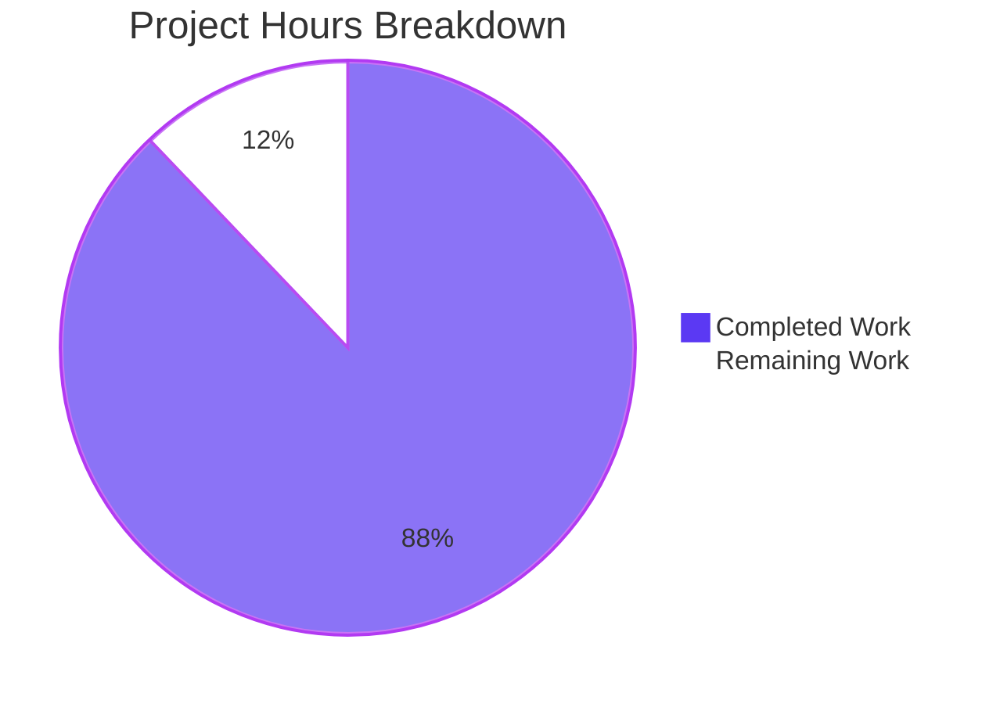

# 1. Executive Summary

What was delivered, what was exercised to prove it works, and what remains open.

## 1.1 Project Overview

A teaching server: one loopback listener, no database, no build step, no user interface, aimed at a developer learning how a Node.js HTTP server is assembled. It now shows two ways of serving a route — the runtime's own handler for `GET /hello` and an Express route for `GET /evening`. This delivery added the framework as the first dependency, preserved the existing endpoint byte for byte, extended the server's one boundary convention to the new path, added an automated check for it, and corrected the tutorial.

## 1.2 Completion Status



| Metric | Value |
|---|---|
| Total Hours | 66 |
| Completed Hours (AI + Manual) | 58 |
| Remaining Hours | 8 |
| **Completion** | **88%** (58 ÷ 66 × 100 = 87.9%) |

Completion is hours-based and scoped to this delivery: 58 hours delivered of 66 total. All 22 requirements are met and verified; the remaining 8 hours are release verification and one repository decision.

## 1.3 Key Accomplishments

- Express 5.3.0 added as the first dependency: exact pin, committed lockfile, offline-reproducible install.
- `GET /evening` → `200`, `text/plain; charset=utf-8`, 12 bytes, `Good evening`, on the existing listener.
- Non-`GET` on `/evening` → `405` with `Allow: GET` and the 18-byte body.
- `GET /hello` preserved byte for byte, proven by an unmodified five-case regression suite.
- One boundary server-wide: unregistered URLs → `404`, 9 bytes, `Not Found`.
- No `X-Powered-By` and no `ETag` anywhere; the published `200` survives conditional requests.
- One gate — `npm test`, 11 cases in two suites, all passing.
- Tutorial corrected across nine regions: install step, both endpoints, tables, walkthrough, counts.

## 1.4 Critical Unresolved Issues

Six open items stand against the 22 requirements this work was scoped to; none blocks release.

| Issue | Impact | Owner | ETA |
|---|---|---|---|
| The repository's superseded status record (blitzy/documentation/) still describes a no-dependency, four-file project | A reader who opens it before the tutorial reads setup and dependency information that no longer holds | Maintainer | Before or immediately after release |
| An out-of-range `PORT` whose digits overflow a double is reported as `1e+21`/`Infinity` rather than as the value the environment carried (`server.js:112-129`) | One startup-failure message names the resolved number instead of the input, for a value that is rejected either way; exit status, one-line shape and nothing-bound all hold | None required | n/a — accepted, the region is frozen by the plan |
| No dependency review is bound to the delivery: the project ships no audit, coverage or lint tooling by design | Nothing re-checks the 65-package tree after delivery; an audit now reports 0 known vulnerabilities | Maintainer | At release, then per dependency change (1.5 h) |
| The tutorial's Windows `cmd` rows, a cross-host wildcard bind and the bracketed IPv6-literal startup line are published but unexercised here | Documentation claims for platforms this container cannot reach | Maintainer | Before release on the target platform (3 h) |
| The below-floor-runtime guard (Node < 22.18.0) has never executed on a real older runtime | The loud-failure path is covered only by a child-process case and mutation | Maintainer | At release (1.5 h) |
| A fully filtered test run (`--test-name-pattern` matching nothing) never exits, because the suite's listener is not torn down | A developer running a filtered selection waits instead of seeing an empty result | Maintainer | Optional (1 h) |

## 1.5 Access Issues

No access issues identified. The project needs no credential, secret, private registry or network service; its dependency installs offline from a warm cache and the server binds loopback only and calls nothing outbound.

## 1.6 Recommended Next Steps

1. **[High]** Run the dependency review at release: `npm ls --depth=0`, `npm audit --omit=dev` (1.5 h).
2. **[Medium]** Verify the tutorial's Windows `cmd` rows, a cross-host bind and the IPv6 startup line on the target platform (3 h).
3. **[Medium]** Exercise the runtime-floor guard below Node 22.18.0 (1.5 h).
4. **[Medium]** Decide the repository status of the superseded status record under `blitzy/documentation/` (1 h).
5. **[Low]** Name the supported test invocations so a filtered run exits (1 h).

# 2. Project Hours Breakdown

Hours are counted against the work this delivery was scoped to: the requirements it implements and the release verification they still need. Completed hours and remaining hours are itemised below, and their sum is the total in Section 1.2.

## 2.1 Completed Work Detail

Hours are measured against the delivered work: implementation, its automated checks, the reader-facing documentation the change made necessary, and the end-to-end verification the contract required. Each component traces to the requirements it completes.

| Component | Hours | Description |
|---|---|---|
| Express dependency, exact pin and reproducible install | 7 | `express@5.3.0` declared as an exact version in `package.json`, resolved into a committed `package-lock.json` (lockfileVersion 3, 65 entries, sha512 integrity and registry URLs on every one), the installed tree kept out of the delivery by a one-line `.gitignore`, and an install shown to reproduce the same tree offline. |
| Express application: overrides, the `/evening` writer and the fallback composition | 10 | `app.js` — the advertisement header and entity tag turned off, strict and case-sensitive routing turned on, the `GET /evening` writer that publishes `200`, `text/plain; charset=utf-8`, a byte-counted 12 and `Good evening`, and the mount that hands every unclaimed request to the project's own handler. |
| Method gate and the unified boundary | 7 | The `405` gate registered ahead of the route with `Allow: GET` and the 18-byte `Method Not Allowed` body for every non-`GET` including `HEAD`; the listener composed from the application; the two-line change in `server.js`; the module's unchanged surface and its bind-free import. |
| Existing endpoint preservation and its regression proof | 5 | `handleRequest`, `respond` and the body constants left byte-identical, `GET /hello` and both boundary answers re-verified live, and the original five-case suite run unmodified against the composed server. |
| The second endpoint's automated suite | 8 | `test/evening.test.js` — six cases over a real socket in the existing suite's shape, with the literal contract values, the two extended `404`s, the gate for `POST` and `HEAD`, the conditional-request answer, the accepted query-string form and the single-listener composition. |
| Test invocation wiring | 1 | The manifest's test script widened to the quoted glob that resolves both suite files, which the runtime requires (a bare directory argument fails), with the start script unchanged. |
| Reader-facing tutorial correction | 9 | The nine regions of `TUTORIAL.md`: the install step, the endpoint set, the `/evening` exchange and its contract row, the boundary table with the per-path matching rule and the accepted divergence, the six-section file walkthrough, the eleven-case table, and the nine tracked paths with the corrected locator clause. |
| Divergence disclosure and the held-identical files | 2 | The accepted divergence recorded in both the code and the tutorial, and `README.md` plus the repository's earlier status record verified byte-identical to their pre-change blobs. |
| End-to-end verification of the delivered contract | 6 | Live contract sweeps over both endpoints, the header-freedom proof, a differential comparison against the pre-change handler, mutation probes of both header settings and of the boundary, and browser rendering of all three answers. |
| Scope discipline: the exclusions held | 3 | No third endpoint, no request parsing, no auth, TLS, CORS, rate limiting, logging, metrics or health surface, no second dependency and no added tooling — each verified absent rather than assumed. |
| **Total** | **58** | Equals the Completed Hours in Section 1.2. |

## 2.2 Remaining Work Detail

Each category below traces to a requirement this delivery carries or to the release verification that requirement still needs.

| Category | Hours | Priority |
|---|---|---|
| Release-time dependency review of the 65-package tree (the project ships no audit tooling by design) | 1.5 | High |
| Platform verification of the tutorial's command tables and bind forms (Windows `cmd` rows, cross-host wildcard bind, bracketed IPv6 startup line) | 3 | Medium |
| Verification of the runtime-floor guard on a Node line below 22.18.0 | 1.5 | Medium |
| Decision and update for the superseded status record under `blitzy/documentation/` | 1 | Medium |
| Optional hardening of the test invocation surface (a filtered run currently does not exit) | 1 | Low |
| **Total** | **8** | Equals the Remaining Hours in Section 1.2 and the Remaining Work value in Section 7. |

## 2.3 Estimation Basis and Confidence

Completed hours are per delivered component and cover the work actually performed: the implementation, the six-case suite with its discriminating assertions, the tutorial rewrite, and the verification the contract required — live contract sweeps, differential checks against the pre-change handler, mutation probes and browser rendering. Remaining hours are the release-time steps a human performs off this container: a dependency review, verification of the documentation's platform-specific claims, a run of the runtime-floor guard on an older runtime, one repository decision, and one optional hardening.

Confidence: high on completed hours and on the release-verification estimates for the documentation and runtime items, whose scope is a single command or bind to observe. Medium on the dependency review, whose extent depends on what the advisories report at release time, and on the record decision, whose cost depends on whether the file is regenerated or marked as superseded. The delivery carries no unknown-scope item: every requirement was implemented, exercised and seen working on this host, and the remaining work is verification of platform-specific claims and one repository decision rather than unbuilt functionality.

# 3. Test Results

Both suites were executed on the delivered tree from the repository root. The whole-package gate is `npm test`, which runs `node --test "test/*.test.js"`.

| Area / Category | Framework | Tests | Passed | Failed | Coverage | What This Proves |
|---|---|---|---|---|---|---|
| Existing endpoint and its boundary (`test/hello.test.js`) | `node:test` + `node:assert/strict`, over a real socket | 5 | 5 | 0 | not measured | `GET /hello` answers `200` with the exact status, media type, 11-byte count and body it answered before the framework arrived, and an unknown path, a trailing-slash path and a non-`GET` all keep their `404`/`405` answers. |
| New endpoint, method gate and composition (`test/evening.test.js`) | `node:test` + `node:assert/strict`, over a real socket | 6 | 6 | 0 | not measured | `GET /evening` answers the published `200` contract, the gate answers every other method with `405` and `Allow: GET`, `/evening/` and `/EVENING` are `404`, a conditional request still gets the published `200`, and `/hello` is served by the same listener. |
| Whole-package gate (`npm test`) | `node:test` with the manifest's quoted glob | 11 | 11 | 0 | not measured | One command from the repository root exercises both endpoints on the composed listener and returns the pass/fail signal as its exit status. |

Run: `npm test` → `1..11`, tests 11, pass 11, fail 0, exit 0, ~254 ms. Module selectors were run separately and are green as well (`node --test test/evening.test.js` → 6 cases, 0 failures; `node --test test/hello.test.js` → 5 cases, 0 failures). No coverage figure is reported because the project ships no coverage tooling — a deliberate exclusion, not a gap in the run.

**Not Covered** — capabilities that are delivered but exercised by no test, and what a human should check before release:

- **Comment and tutorial prose.** The JSDoc in `app.js` and `server.js`, the comments in `test/evening.test.js`, and `TUTORIAL.md`'s wording have no executable surface: no test and no run can assert them. Every factual claim they make was re-derived against the running system when written, but a later edit to them is caught by review only.
- **The uncomposed application.** `createApp()` without a fallback is unreachable in the delivered system (`server.js` always passes `handleRequest`) and carries no committed case, deliberately; a future caller that imports the factory directly should be tested by whoever adds that caller.
- **The runtime-floor guard.** The entry point's loud failure below Node 22.18.0 is covered only by the child-process case and by mutation; no older runtime exists here to run it against (Section 1.6, item 3).
- **Platform-specific documented forms.** The tutorial's two Windows `cmd` override rows, a cross-host wildcard bind, and the bracketed IPv6-literal startup line are published but cannot be exercised in this container (Section 1.6, item 2).
- **A filtered test run.** Invoking the runner with a name filter that matches nothing does not exit, because the suite's listener stays open; no test covers the runner's own invocation surface (Section 1.6, item 5).
- **Load and performance characteristics.** No latency, throughput or memory budget is asserted; concurrency and hostile-input behaviour were probed by hand during delivery but are not pinned by the suite.
- **Dependency advisories.** No audit tool, linter or formatter is bound to the gate, so nothing in the project re-checks the 65-package tree after delivery (Section 1.6, item 1).
- **The six exercises the tutorial sets the reader.** They are delivered as reader work, byte-identical to their pre-change text, and are intentionally not implemented.

# 4. Runtime Validation & UI Verification

- ✅ **Startup and configuration** — `PORT=<port> node server.js` (equivalently `npm start`) binds one loopback listener and prints exactly one line, `Server listening on http://127.0.0.1:<port>`; `HOST` and `PORT` remain the whole configuration and the startup line's form is unchanged.
- ✅ **Existing endpoint** — `GET /hello` → `200`, `text/plain; charset=utf-8`, `Content-Length: 11`, body `Hello world`, driven both over `curl` and from the running server's own child process.
- ✅ **New endpoint** — `GET /evening` → `200`, `text/plain; charset=utf-8`, `Content-Length: 12`, 12 bytes counted off the socket, body `Good evening`.
- ✅ **Conditional requests** — `If-None-Match: *` (alone and with `cache-control: max-age=0`), a stale token and a stale `If-Modified-Since` all leave the published `200` and its content headers intact on both endpoints; no `304` is produced.
- ✅ **Method gate** — `POST`, `PUT`, `DELETE` and `HEAD` on `/evening` → `405 Method Not Allowed` with `Allow: GET`, `text/plain; charset=utf-8` and declared `Content-Length: 18`; the `HEAD` body measured at zero bytes.
- ✅ **Unknown-URL boundary** — `/nope`, `/evening/`, `/EVENING`, `/evening/x`, `/hello/`, `/HELLO` and `//hello` → `404`, `Content-Length: 9`, body `Not Found`, answered by the project's own handler rather than the framework's HTML page.
- ✅ **Response header surface** — every answer of both endpoints carries only `Content-Type`, `Content-Length`, `Date`, `Connection` and `Keep-Alive` (plus `Allow` on a `405`): no `X-Powered-By`, no `ETag`, no `Transfer-Encoding`.
- ✅ **Failure paths** — an invalid `HOST`/`PORT` and a port already in use each produce exactly one stderr line, a non-zero exit, no stack trace, no retry and nothing bound; importing the module binds nothing at all.
- ✅ **Client rendering** — all three answers were loaded in a headless browser: both `200`s and the `404` render as plain text with the expected body, and the only console entry is the browser's own automatic `/favicon.ico` request against the documented `404`.
- ⚠ **No outbound integration exists to exercise** — the system holds no database, cache, queue, store, webhook or third-party service, and writes no persistent record, so the only external interaction is the npm install of its single dependency.

No screen, route or flow in this project is failing. **Never exercised at runtime:** the entry point on a Node line below 22.18.0 (no second runtime exists here); the tutorial's Windows `cmd` forms; a wildcard `HOST` reached from another host, and the bracketed IPv6-literal startup line; the framework-served route under an application built without the fallback (unreachable in the delivered system); and a fully filtered test run, which hangs on its own listener rather than exiting.

# 5. Compliance & Quality Review

Each row below maps a delivered capability to the benchmark it is held to, with the state it is in now and the evidence behind the verdict.

## 5.1 Compliance Matrix

| # | Deliverable | Benchmark | Status | Evidence |
|---|---|---|---|---|
| 1 | Requirement fidelity — every recorded requirement implemented as specified | Functional completeness | ✅ PASS | 22 of 22 requirements met and verified on the delivered tree (Section 5.2 records the five places the delivery departs from the plan's letter while still meeting its requirement). |
| 2 | Existing-contract preservation | Backward compatibility | ✅ PASS | `handleRequest`, `respond` and the body constants byte-identical to `origin/main`; the five-case suite unmodified and green; live answers identical to the pre-change handler's. |
| 3 | Dependency governance | Supply-chain control | ✅ PASS | Exact pin in the manifest; committed lockfile with 65 entries, sha512 integrity and registry URLs on all of them; installed tree absent from the delivery; `npm audit --omit=dev` reports 0 known vulnerabilities today. |
| 4 | Automated verification | Contract test coverage | ✅ PASS | 11 cases across two suites over real sockets, one command, exit status as the signal; the boundary and header assertions are load-bearing under mutation. |
| 5 | Error handling and failure reporting | Robust operations | ✅ PASS | One-line failure reports on a non-zero exit with no stack trace and no retry; no malformed or hostile request produced a `500`, a hang, a crash or an internal detail. |
| 6 | Security posture | Information disclosure and exposure | ✅ PASS | Advertisement header and entity tag suppressed; loopback-only default bind; no identity, secret, PII or caller-supplied value is read, stored, logged or reflected. |
| 7 | Input validation | Defensive programming | ✅ PASS | `HOST` and `PORT` validated before the bind, with defaults that bound exposure; no request body, header, cookie or query is parsed by either endpoint. |
| 8 | Code quality and repository conventions | Maintainability | ✅ PASS | ES modules with extension-carrying specifiers, why-prose JSDoc at each non-obvious decision, module-private body constants, literal expectations in tests, no placeholder or dead code in the tracked sources. |
| 9 | Documentation accuracy | Reader trust | ✅ PASS | The tutorial's nine corrected regions state the endpoint set, the install step, the contract and boundary tables, the file walkthrough, the case count and the tracked-path count as the delivered code behaves. |
| 10 | Delivery hygiene | Release readiness | ✅ PASS | Only the planned paths tracked; `node_modules` ignored by a one-line rule and never committed; no build output, temp file or captured artefact in the delivery. |
| 11 | Observability | Operability | ✅ PASS (bounded) | One startup line and two single-line failure reports, which is the whole intended surface; no metrics, tracing or logging exists by design. |
| 12 | Coverage measurement | Verification completeness | ⚠ NOT MEASURED | No coverage tooling is configured or permitted by the project's stated scope, so line and branch coverage of `app.js` and `server.js` is unknown; mutation probes are the compensating evidence. |

## 5.2 AAP & Rule Divergences and Gaps

Five divergences were established: places where the delivered code or documentation departs from what the Agent Action Plan specified, while the requirement it serves is still met.

| What the AAP/Rule Required | What Was Delivered Instead | Why It Diverged | Impact | Remediation |
|---|---|---|---|---|
| The new endpoint's answer shown as `res.status(200).type('text/plain').send('Good evening')` | The writer sets the status, the media type and a byte-counted `Content-Length` and ends the body directly (`app.js:87-91`) | The framework's own sender treats a request carrying `If-None-Match: *` as conditional and answers `304`, dropping the media type, the length and the body — which would make the framework-served endpoint distinguishable from the hand-written one, breaking the plan's own contract table and its requirement that a caller cannot tell which endpoint the framework serves | None on any published value: `200`, `text/plain; charset=utf-8`, 12 bytes and `Good evening` are exactly the specified ones, and the conditional-request answer is the published `200` | None required. A future revision of the plan should show the direct write so code and plan agree. |
| Attribution of the framework's use as "the only file that names `express`" | The tutorial says "the only source file whose code names `express`" (`TUTORIAL.md:274`, `:302`) | `package.json` and the lockfile both name the package, so the unqualified sentence is false as delivered; the qualified one keeps the intended point that `app.js` alone owns the framework | None: wording only — the delivered sentence is true, the plan's literal phrase is not | None. If the plan's phrase is restated, "source file" is the wording that holds. |
| Six enumerated cases for the new endpoint, with the values each asserts | The same six cases under the same names, asserting more: the 9-byte length and body on both `404` cases, the media type on the `HEAD` `405`, header freedom on `/hello`, and the conditional-request answer, `/evening/x` and `/evening?x=1` pinned inside existing cases | The conditional-request answer and the accepted divergence would otherwise have been pinned by prose alone, and the strengthened assertions are what make the suite fail if the fallback mount, the gate or either header setting is removed; the plan's exclusions name tooling rather than assertions | Positive: the suite is strictly stronger, and every value the plan enumerated is asserted unchanged | None. |
| `server.js`'s pre-bind port-rejection region held byte-identical | Held byte-identical — so an out-of-range `PORT` whose digits overflow a double is named as `1e+21`/`Infinity` rather than as the value the environment carried (`server.js:112-129`) | The plan freezes that region and states that the file's only changes are the import and the composed listener; the region's behaviour is otherwise unchanged, and the alternative would be a change the plan forbids | One startup-failure message names the resolved number instead of the input, for a value that is rejected either way; the exit status, the single-line shape, the absence of a stack trace and the guarantee that nothing is bound all hold | None required. A maintainer who wants the environment's text echoed must amend the plan's frozen region first. |
| The repository's earlier status record held byte-identical as the previous delivery's own record | Held byte-identical; it still states that nothing is installed, that the project declares no dependency, that it holds four files, and the previous delivery's hours and test timings | It is that delivery's own record: rewriting its report sections would falsify a historical record, and rewriting only its setup and appendix statements would leave it internally inconsistent; the tutorial is the live reader path and is fully corrected | A reader who opens that file before the tutorial meets setup and dependency information that no longer describes the project | A maintainer should mark it as superseded or regenerate it (Section 1.6, item 4; 1 h). |

No user-specified rule was overridden anywhere in this delivery: the project ships no rules document, and none was supplied with the environment.

**The superseded status record.** The repository holds one document that describes the project as it was before this delivery — no dependency, no install step, a four-file tree — and it was deliberately left untouched as the previous delivery's own status record. The live reader path is `TUTORIAL.md`, corrected in the same change as the code it describes, so anyone following the tutorial gets the delivered behaviour. The consequence is that the repository contains two documents that disagree, and only a human can settle which one survives: mark the older one as superseded, or regenerate it from the delivered system. Until that decision is recorded, a reader who starts from `blitzy/documentation/` is misled about how to install and run the project, and no automated check would catch it.

**The frozen port-rejection region.** `server.js`'s pre-bind validation reports a rejected `PORT` in one line and exits non-zero, which is what the project's failure convention requires. One class of value is reported imprecisely: when `PORT` carries more digits than a double can hold — `PORT=999999999999999999999`, for example — the message names the resolved number (`1e+21`) rather than the digits the environment carried. That is a deliberate consequence of holding the region byte-identical, and the value is rejected either way with the same exit status and nothing bound. A maintainer who wants the environment's text named must first amend the frozen region, because the only change that fixes it is the one the freeze forbids.

# 6. Risk Assessment

Risks below are forward-looking: what could still go wrong in production or in the next change to this codebase, and what holds each one in check today.

| Risk | Category | Severity | Probability | Mitigation | Status |
|---|---|---|---|---|---|
| Exposure widens the moment `HOST` is overridden off loopback: both endpoints become reachable with no authentication, TLS, rate limiting or logging | Security | High | Low | The default bind is loopback-only and the tutorial carries the exposure warning in the same terms as before; `HOST` and `PORT` remain the only configuration surface | Accepted by design |
| The 65-package tree's fixes arrive only through the installed tree: a deleted lockfile or an `npm update` would float the framework's own ranges away from the pinned releases | Security | Medium | Low | Exact pin in the manifest, committed lockfile with sha512 integrity and registry URLs on all 65 entries, and an advisory review recorded as release work (0 known vulnerabilities today) | Mitigated |
| Returning the `/evening` writer to the framework's response sender would silently make that endpoint answer `304` on a conditional request where `/hello` answers `200` | Technical | Medium | Medium | The suite's conditional-request case fails on exactly that change, and the boundary assertions are proven load-bearing under mutation | Mitigated |
| The two routing settings take effect only if they precede the first route registration; a reordering of `app.js` would silently lose the `/evening/` and `/EVENING` `404`s | Technical | Medium | Medium | The two trailing-slash and case-sensitive cases fail when either setting is removed, so the reordering cannot pass review unnoticed | Mitigated |
| The published `200`'s unconditionality and its media type rest on framework behaviour (a direct write bypassing the sender's freshness branch) rather than on a framework-pinned contract | Technical | Medium | Low | The delivered cases assert the published status, media type, length and body on every run, and the header surface is asserted on both framework-written and hand-written answers | Accepted |
| The superseded status record inside the repository contradicts the delivered project for anyone who opens it first | Operational | Medium | Medium | The tutorial is the live reader path and is fully corrected; a maintainer decision on the older record is recorded as remaining work | Open |
| The install is now a hard precondition, and skipping it surfaces a raw module-resolution stack rather than the project's one-line report | Operational | Low | Medium | The tutorial's prerequisites put the install step before every command; the lockfile makes the resolved tree exact and offline-capable | Accepted |
| The framework matches the path component, so `/evening` answers `200` for query-string, fragment and absolute-form targets where `/hello` answers `404` | Integration | Medium | Low | Disclosed in the tutorial's boundary table and in the code's own rationale, and pinned by a delivered case; any future path-based guard must account for the normalization | Accepted |

No risk in this register has a Critical severity, and none of the accepted rows affects a published value, a boundary answer or the preserved endpoint. The `npm audit --omit=dev` run performed during this assessment reported zero known vulnerabilities across the 65 resolved dependencies.

# 7. Visual Project Status


Colour key: Completed work Dark Blue (#5B39F3) · Remaining work White (#FFFFFF) · headings and accents Violet-Black (#B23AF2) · highlights Mint (#A8FDD9).

Remaining hours by category, from Section 2.2:

| Remaining Category | Hours | Priority |
|---|---|---|
| Release-time dependency review | 1.5 | High |
| Platform verification of documented command and bind forms | 3 | Medium |
| Runtime-floor guard verification | 1.5 | Medium |
| Decision on the superseded status record | 1 | Medium |
| Optional hardening of the test invocation surface | 1 | Low |
| **Total remaining** | **8** | — |

# 8. Summary & Recommendations

The project now serves two endpoints from the single listener it always had. `GET /hello` is answered by the same hand-written handler that answered it before this delivery — same status, same media type, same 11 bytes, same body — and `GET /evening` is answered by an Express route that publishes `200`, `text/plain; charset=utf-8`, 12 bytes and `Good evening`. Everything else the server does follows one convention: a non-`GET` on a registered path is `405 Method Not Allowed` with `Allow: GET`, and any other URL is `404 Not Found` with a 9-byte body from the project's own handler rather than the framework's HTML page.

What was exercised to prove it: 11 automated cases across two suites, run by one command from the repository root, all passing, with the pre-existing five-case suite left byte-identical so its green run is a genuine regression proof rather than a re-baselined expectation. On top of the suite, both endpoints and every boundary answer were driven live over real sockets, both endpoints were loaded in a headless browser, the response header surface was inspected answer by answer, the conditional-request behaviour was probed on both paths, the failure paths (`HOST`/`PORT` rejected before the bind, a port already in use) were exercised, and the header settings and the boundary were mutation-checked to show that the assertions fail when the code they pin is removed.

What is still open is verification rather than functionality: coverage is not measured because the project ships no coverage tooling; the runtime-floor guard, the tutorial's Windows command rows and the non-loopback bind forms cannot be exercised in this container; and one decision belongs to a maintainer — what to do with the older status record the repository still carries. Those items are itemised in Sections 1.4, 2.2 and 3, and they account for the 8 remaining hours.

**Production readiness.** Ready for production within its stated scope: a loopback-bound tutorial server with two endpoints, one pinned dependency, one install step and one gate. Both endpoints and every boundary answer match their published contracts from a clean install and a clean boot, the response surface carries neither the framework's advertisement header nor an entity tag, nothing caller-supplied is read, stored, logged or reflected, and the failure paths report in one line with a non-zero exit and nothing bound. The two items to settle before or at release are the advisory review of the 65-package tree and the decision about the older status record in the repository.

The critical path is short: the code, the suite and the tutorial are complete and verified on this host, so release work is a review of the dependency tree, a platform check of the documented commands this container cannot run, and one documentation decision. Success for the next change to this project looks like the same signals the suite already emits — 11 green cases under one command, `GET /hello` unchanged byte for byte, and no header on either endpoint that the published contract does not describe.

# 9. Development Guide

Everything below was run on this checkout while the guide was written. Commands are copy-pasteable and each runs from the repository root unless stated otherwise.

### System prerequisites

- **Node.js 22.18.0 or newer** on the 22.x line (`engines.node` in `package.json`). The entry point uses `import.meta.main`, which does not exist below 22.18.0; on an older runtime the server prints no startup line and exits silently, so a version check comes first. Verified here on **Node v22.23.4**.
- **npm 11.x** (verified on 11.21.0).
- No database, no message broker, no container, no compiler and no build step. `git` only if you intend to work with the history.
- The server binds loopback (`127.0.0.1`) by default, so nothing external has to be reachable and no credential is needed.

```bash
node --version   # must be >= 22.18.0, e.g. v22.23.4
npm --version    # e.g. 11.21.0
```

### Install the dependency

The project has exactly one dependency, pinned to an exact version and resolved in the committed lockfile. An install step now precedes the first run and the first test.

```bash
npm install          # fresh checkout: resolves express@5.3.0 from the lockfile
# or, when the tree is already resolved and you want the lockfile honoured exactly:
npm ci
# on a host with a warm npm cache, this needs no network at all:
npm ci --offline
```

Expected result: the install reports the resolved packages (`express@5.3.0` at the top level, 65 entries in the tree) and exits 0. Confirm what resolved:

```bash
npm ls --depth=0
# nodejs-hello-world-tutorial@1.0.0
# └── express@5.3.0
```

`node_modules/` is ignored by `.gitignore` and must never be committed.

### Static check (no compiler in this project)

```bash
node --check app.js server.js test/evening.test.js test/hello.test.js
```

The command prints nothing and exits 0 when the files parse. It is the whole static gate: the project deliberately ships no linter, formatter, type checker or bundler.

### Run the server

```bash
npm start                      # binds 127.0.0.1:3000
PORT=4555 npm start            # a different port
PORT=4555 HOST=127.0.0.1 node server.js   # the same thing without npm's banner
```

Expected output — exactly one line, on stdout:

```
Server listening on http://127.0.0.1:4555
```

`HOST` and `PORT` are the complete configuration surface; both default to loopback and port 3000. The endpoint answers are then:

```bash
curl -i http://127.0.0.1:4555/hello      # 200, text/plain; charset=utf-8, 11 bytes, Hello world
curl -i http://127.0.0.1:4555/evening    # 200, text/plain; charset=utf-8, 12 bytes, Good evening
curl -i -X POST http://127.0.0.1:4555/evening   # 405, Allow: GET, 18 bytes, Method Not Allowed
curl -I  http://127.0.0.1:4555/evening          # 405 with the same headers and no body
curl -i http://127.0.0.1:4555/nope       # 404, Content-Length: 9, Not Found
```

Stop the server with `Ctrl-C`.

### Test

```bash
npm test        # runs node --test "test/*.test.js"
```

Expected result:

```
1..11
# tests 11
# pass 11
# fail 0
```

Exit status 0 means the suite passed; the runner's exit status is the gate. Useful variants, all run **from the repository root**:

```bash
node --test test/evening.test.js     # the new endpoint's six cases: 6 pass, 0 fail
node --test test/hello.test.js       # the preserved endpoint's five cases: 5 pass, 0 fail
npm test -- --test-concurrency=1     # serial execution, the same 11 cases
```

The quotes around the glob are required: the bare directory form `node --test test/` fails on this runtime. Both suites bind an OS-assigned port, so port 3000 need not be free for a test run.

### Troubleshooting

| Symptom | Cause | Resolution |
|---|---|---|
| `ERR_MODULE_NOT_FOUND: Cannot find package 'express'` when running `npm start` or `npm test` | The install step has not run in this checkout | Run `npm install` (or `npm ci`, or `npm ci --offline` from a warm cache) from the repository root. |
| The server prints no startup line and exits immediately | The runtime is older than 22.18.0, where `import.meta.main` does not exist | Install a Node line at or above 22.18.0 (`node --version`). |
| `Could not start the server: the port must be an integer from 0 to 65535, but received "abc"` | `PORT` is not an integer in 0–65535; the value is shown as the environment wrote it | Set `PORT` to a valid port, or unset it to use 3000. Nothing is bound and the exit status is 1. |
| `Could not start the server: listen EADDRINUSE: address already in use 127.0.0.1:3000` | Something already holds the port | Start on another port (`PORT=4555 npm start`) or stop the process holding 3000. The server never retries. |
| A `404` arrives as an HTML page (`Cannot GET /path`) with a three-digit `Content-Length` instead of the 9-byte `Not Found` | The framework is answering instead of the project's handler — normally because the fallback mount at the end of `app.js` is missing | Restore `app.use(fallback)` as the last registration in `app.js`. |
| A response carries `X-Powered-By` or `ETag` | One of the two settings in `app.js` was removed | Restore `app.disable('x-powered-by')` and `app.set('etag', false)`; `npm test` fails on the `405` cases when the `etag` setting is missing. |
| `GET /evening/` or `GET /EVENING` answers `200` | The strict and case-sensitive routing settings are missing, or were set after the first route registration | Set `app.set('strict routing', true)` and `app.set('case sensitive routing', true)` before any route is registered. |
| One test case fails with the child process's stderr quoted | The suite was started from another directory | Run `npm test` (or a bare `node --test` invocation) from the repository root; the child-process case spawns `server.js` relative to the process working directory. |
| A `node --test --test-name-pattern=…` run appears to hang | A filter that matches no case leaves the suite's listener open, so the process never exits | Interrupt it and run the full suite, or a single test file by path. |

# 10. Appendices

Everything a maintainer needs to find a command, a port, a path, a version or a term, in one place. Values are the ones observed on the delivered tree.

## A. Command Reference

| Command | Purpose | Expected result |
|---|---|---|
| `node --version` | Confirm the runtime floor | `v22.23.4` here; must be `>= 22.18.0` |
| `npm --version` | Confirm the package manager | `11.21.0` here |
| `npm install` | Install the single dependency on a fresh checkout | 65 packages resolved, exit 0 |
| `npm ci` / `npm ci --offline` | Reproduce the lockfile exactly (offline works from a warm cache) | exit 0 in ~0.6 s |
| `npm ls --depth=0` | Confirm the resolved pin | `└── express@5.3.0` |
| `npm audit --omit=dev` | Advisory check over the production tree | reports 0 known vulnerabilities today |
| `node --check <file>` | Static parse gate (the project has no compiler) | silent, exit 0 |
| `npm start` | Start the server (`node server.js`) | `Server listening on http://127.0.0.1:3000` |
| `PORT=<port> npm start` | Start on a chosen port | the same startup line with that port |
| `npm test` | Run both suites (`node --test "test/*.test.js"`) | `1..11`, 11 pass, 0 fail, exit 0 |
| `node --test test/evening.test.js` | Run only the new endpoint's cases | 6 pass, 0 fail |
| `node --test test/hello.test.js` | Run only the preserved endpoint's cases | 5 pass, 0 fail |
| `curl -i http://127.0.0.1:<port>/hello` | Inspect the preserved endpoint | `200`, `text/plain; charset=utf-8`, 11 bytes, `Hello world` |
| `curl -i http://127.0.0.1:<port>/evening` | Inspect the new endpoint | `200`, `text/plain; charset=utf-8`, 12 bytes, `Good evening` |
| `curl -i -X POST http://127.0.0.1:<port>/evening` | Inspect the method gate | `405`, `Allow: GET`, 18 bytes, `Method Not Allowed` |
| `git rev-list --count origin/main..HEAD` | Count this delivery's commits | `12` |
| `git diff --numstat origin/main...HEAD` | Size the change set | seven paths; `server.js` `2 1` |

## B. Port Reference

| Port | Owner | Notes |
|---|---|---|
| `3000` | The server's default (`PORT` unset) | Loopback only (`127.0.0.1`). Free it before starting a second instance. |
| `0` | The test suites | Both suites pass `port: 0`, so the OS assigns a free port and a test run never collides with a running server or another checkout. |
| Any other free port | `PORT=<port> npm start` | The documented way to run several instances side by side, or to avoid a port already in use. |

There is one listener and one port in the whole system: the server creates it once inside `start()`, never at import time, and never opens a second one. A port already in use is reported in one line and the process exits without retrying.

## C. Key File Locations

| Path | Role |
|---|---|
| `server.js` | Entry point: `HOST`/`PORT` resolution and validation, the single response writer, the hand-written `handleRequest` for `/hello` and its boundary answers, the two one-line failure reporters, and `start()`, which composes the listener. |
| `app.js` | The Express application: framework defaults overridden, the `405` gate for `/evening`, the `GET /evening` writer, and the fallback mount. The only source file that names the framework. |
| `test/hello.test.js` | The preserved endpoint's five cases, including the child-process case that starts the entry point end to end. Unchanged by this delivery. |
| `test/evening.test.js` | The new endpoint's six cases: contract, boundary, gate, conditional request, the accepted query-string form and the single-listener composition. |
| `package.json` | Manifest: the exact dependency pin, the `start` and `test` scripts, the runtime floor and the description naming both endpoints. |
| `package-lock.json` | The resolved 65-package tree (lockfileVersion 3) with integrity hashes, committed so installs are reproducible. |
| `.gitignore` | One line, `node_modules/`, keeping the installed tree out of the delivery. |
| `TUTORIAL.md` | The reader-facing tutorial: prerequisites and install step, both endpoints, contract and boundary tables, the six-section file walkthrough, the eleven-case table and the project's tracked-path count. |
| `README.md` | Two-line generator stub, unchanged by this delivery and holding no setup or dependency claims. |
| `blitzy/documentation/` | The repository's earlier status record, left byte-identical as that delivery's own record and superseded by `TUTORIAL.md` (Section 5.2). |

## D. Technology Versions

| Component | Version | Notes |
|---|---|---|
| Node.js | v22.23.4 here; floor `>=22.18.0` | The floor is a feature floor: `import.meta.main` is the entry-point guard the server uses. |
| npm | 11.21.0 here | Used for the install step and for the two scripts; the repository ships no `.npmrc`. |
| express | 5.3.0 | The project's only dependency, pinned exactly in `package.json` and resolved in `package-lock.json`. |
| Resolved dependency tree | 65 packages | express plus its 64 transitive packages, all with sha512 integrity hashes from the public npm registry. |
| Test runner | `node:test` + `node:assert/strict` | The runtime's own runner over real sockets; no test framework is installed. |
| Lockfile format | lockfileVersion 3 | A different npm major could legitimately rewrite the file, so the committed bytes are this host's npm output. |
| Coverage / lint / audit tooling | none | Excluded by the project's stated scope; `node --check` and the suite are the whole gate. |

## E. Environment Variable Reference

| Variable | Default | Effect |
|---|---|---|
| `HOST` | `127.0.0.1` | The address the listener binds. An empty or whitespace-only value is treated as unset, and the default bounds exposure to the local machine. Overriding it to a wildcard address publishes both endpoints to whoever can reach the machine. |
| `PORT` | `3000` | The port the listener binds. Validated before the bind: a value that is not an integer from 0 to 65535 produces one stderr line and a non-zero exit with nothing bound. |

No other environment variable is read. The project needs no secret, no token and no credential of any kind, and neither endpoint reads the request body, headers, cookies or query string. `HOST` and `PORT` are the complete configuration surface; there is no configuration file, no `.env` file and no environment template in the repository.

## F. Developer Tools Guide

| Tool | Use |
|---|---|
| `node --check` | The read-only static gate. Parse a file without executing it; silent, exit 0. |
| `node --test` | The test runner. `npm test` wraps it with the quoted glob that resolves both suite files. |
| `curl` | The fastest way to inspect a contract by hand; `-i` shows the status line and headers, `-I` issues a `HEAD`. |
| A browser | Renders the same plain text a client sees. Both endpoints and the `404` render as text, and a fresh profile logs one console entry for its own automatic `/favicon.ico` request against the documented `404`. |
| `/proc/net/tcp` and `/proc/net/tcp6` | How a listener is confirmed on a host with no `ss`, `netstat`, `lsof` or `fuser`: a listening entry is state `0A`, and the IPv4 loopback address appears as `0100007F` with the port in hexadecimal. |
| `git diff --numstat origin/main...HEAD` | Sizes the change set; `server.js` reports `2 1`, which is the whole regression surface of the composed listener. |
| `npm audit --omit=dev` | Advisory check over the production tree; run it at release and after any dependency change, since no audit step is bound to the gate. |

## G. Glossary

| Term | Meaning in this project |
|---|---|
| Endpoint | One method-and-path pair the server answers: exactly `GET /hello` and `GET /evening`. |
| Boundary | The answers the server gives for everything else: `404 Not Found` (9-byte body) for an unregistered URL, `405 Method Not Allowed` with `Allow: GET` (18-byte body) for a non-`GET` on a registered path. |
| Fallback | The project's own hand-written handler (`handleRequest` in `server.js`), mounted last in `app.js` so it answers every request the framework's routes do not claim. |
| Composition | The single listener built as `createServer(createApp({ fallback: handleRequest }))` in `start()`. |
| Gate | The `app.all('/evening')` handler registered ahead of the route, which answers every non-`GET` with the `405` contract so `HEAD` and the other methods take the same branch. |
| Header freedom | The published property that no answer carries `X-Powered-By` or `ETag`, enforced by two settings in `app.js`. |
| Conditional request | A request carrying `If-None-Match` or `If-Modified-Since`; both endpoints answer the full published `200` rather than a `304`, which is why the new endpoint's answer is written directly. |
| Accepted divergence | The one place the two endpoints differ by URL form: `/evening` is matched by path component, so `GET /evening?x=1` is `200` while `GET /hello?x=1` is `404`. Documented, not normalised. |
| Tracked paths | The nine files the project itself commits (`.gitignore`, `README.md`, `TUTORIAL.md`, `app.js`, `package-lock.json`, `package.json`, `server.js`, `test/evening.test.js`, `test/hello.test.js`), with the repository's earlier status record under `blitzy/` counted separately. |
| Superseded status record | The older generated document under `blitzy/documentation/`, describing the project before this delivery and superseded by `TUTORIAL.md`; it awaits a maintainer decision (Section 5.2). |
